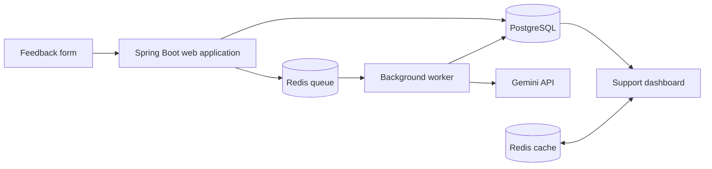

# InsightDesk

**AI-assisted feedback management with asynchronous processing and containerized deployment.**

InsightDesk turns incoming customer feedback into structured information that a support team can review and prioritize. Users submit a message through a web form; a background worker uses Gemini AI to classify it, summarize it and suggest a reply. A dashboard brings the results together with filtering and pagination.

Developed by **Aylin Minayi** as a software engineering internship project at **CloudPro**.

[Developer portfolio](https://aylinminayi.github.io/) · [Source code](https://github.com/aylinminayi/insightdesk)

## Features

- Feedback form with a title, message and optional contact email.
- AI analysis of sentiment, category and urgency, plus a summary and suggested reply.
- Background processing through a Redis queue so feedback submission does not wait for the AI response.
- Required-field and allowed-value validation of Gemini's JSON output.
- Retry handling with a maximum of three attempts and a `failed` status for exhausted jobs.
- Recovery of unfinished jobs from the processing queue when the worker starts.
- Dashboard filters for status, category, sentiment and urgency; newest-first pagination.
- Redis-backed dashboard caching with cache eviction when feedback changes.
- Separate API and worker containers built from the same application image.
- Docker Compose configuration, Kubernetes manifests and a GitHub Actions deployment workflow.

## Architecture



1. The application saves a feedback record in PostgreSQL and queues its ID in Redis.
2. The worker moves an ID into a processing list and marks the record as `analyzing`.
3. Gemini returns structured analysis. The application validates required fields and accepted classification values before storing the result.
4. Successful analysis updates the feedback record and clears cached dashboard queries.
5. Failed jobs are requeued until the attempt limit is reached, then marked `failed`.

The worker is enabled with `APP_WORKER_ENABLED=true`; the web application container uses `false`.

## Technology stack

| Area | Technologies |
| --- | --- |
| Backend | Java 21, Spring Boot, Spring MVC, Spring Data JPA, Maven |
| Web interface | Thymeleaf |
| Persistence and messaging | PostgreSQL 16, Redis 7 |
| AI integration | Google Gemini API, Google Gen AI Java SDK |
| Containers and orchestration | Docker, Docker Compose, Kubernetes |
| Delivery | GitHub Actions, Docker Hub, self-hosted runner |

## Run locally with Docker Compose

### Prerequisites

- Docker with Docker Compose support.
- A Gemini API key with access to the model configured in `GeminiAnalyzerService.java`.
- Available local ports `8080`, `5432` and `6379`.

### Start the application

```bash
git clone https://github.com/aylinminayi/insightdesk.git
cd insightdesk
```

Create a local `.env` file in the repository root:

```dotenv
POSTGRES_PASSWORD=replace_with_a_local_database_password
GEMINI_API_KEY=replace_with_your_gemini_api_key
```

Keep actual credentials out of version control. Build the shared image before starting all four services:

```bash
docker compose build api
docker compose up -d
```

Open the [feedback form](http://localhost:8080/) and [dashboard](http://localhost:8080/dashboard).

PostgreSQL may still be initializing when the application containers first start; the Compose file uses startup dependencies without database health checks. If the API or worker exits during initialization, wait for PostgreSQL to be ready and restart them:

```bash
docker compose restart api worker
```

### Try the workflow

1. Submit a sample message such as “Checkout fails when I confirm my order.”
2. Open the dashboard and observe its processing status.
3. Once analysis finishes, review the sentiment, category, urgency, summary and suggested reply.
4. Filter the dashboard to inspect a subset of records.

Inspect service output or stop the application:

```bash
docker compose logs -f api worker
docker compose down
```

`docker compose down` preserves the named PostgreSQL volume.

## Web routes

| Method | Route | Purpose |
| --- | --- | --- |
| GET | `/` | Display the feedback form |
| POST | `/feedback` | Submit form fields `title`, `body` and optional `contactEmail` |
| GET | `/dashboard` | Review feedback; accepts `status`, `category`, `sentiment`, `urgency` and zero-based `page` parameters |

These routes serve a Thymeleaf web interface; they are not a standalone JSON REST API.

## Deployment

The `k8s/` directory contains manifests for the namespace, PostgreSQL storage, PostgreSQL, Redis, API, worker and ingress. API and worker configuration is supplied through a ConfigMap and a separately provisioned `insightdesk-secret` containing `POSTGRES_PASSWORD` and `GEMINI_API_KEY`.

The GitHub Actions workflow runs on pushes to `main` using a self-hosted runner. It builds and pushes the Docker image, applies the deployment manifests and restarts the API and worker deployments. It requires Docker Hub credentials (`DOCKER_USERNAME` and `DOCKER_TOKEN`) and an already configured Kubernetes environment. The workflow does not create the application secret or provision a cluster.

## Repository guide

```text
src/main/java/insightdesk/
  HomeController.java          Feedback submission and dashboard routes
  Feedback.java                Feedback and analysis data model
  FeedbackRepository.java      Persistence and specification queries
  FeedbackAnalyzerWorker.java  Queue processing, recovery and retries
  GeminiAnalyzerService.java   Gemini integration and response validation
  DashboardService.java        Filtering, pagination and cache eviction
  CacheConfig.java             Caching configuration
src/main/resources/templates/  Thymeleaf pages
compose.yaml                   Local four-service setup
Dockerfile                     Multi-stage Java image build
k8s/                           Kubernetes manifests
.github/workflows/deploy.yml   Image build and deployment workflow
```

## Scope and limitations

InsightDesk is an internship and learning project. The repository includes a Spring application-context test, but does not establish comprehensive automated test coverage or production performance benchmarks. The Docker image build currently skips tests.

Before using real customer data, the application needs a production security review, access controls and a data-handling policy. Feedback titles and message bodies are sent to the external Gemini API for analysis. Suggested replies should be reviewed by a person before use.
